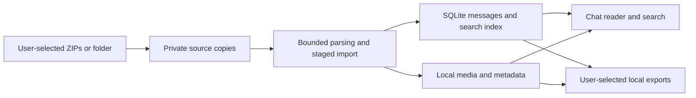

# Engineering and project provenance

Snap Explorer is a native Android adaptation for reading Snapchat exports
locally. The goal is to make an existing archive searchable and usable on a
phone while retaining its original records.

## Project-specific Android work

The implementation in this repository includes:

- A Java Android interface for conversations, archive search, media, and metadata.
- Streaming HTML/JSON imports, multipart ZIP merging, staged writes, and retries.
- SQLite storage, full-text search, paged results, match highlighting, and arrows.
- Reversible repeat hiding, explicit sender selection, pins, and chat groups.
- Local attachment indexing, media previews, and portable backup/restore.
- Synthetic regression fixtures and host/device checks for import and UI behaviour.

These are descriptions of the implementation in this repository, not a claim
that the export format, upstream product concept, or all supporting components
were invented here.

## Existing projects and dependencies

| Source | Role in this project |
| --- | --- |
| [Snap Data Explorer](https://github.com/KodyDennon/SnapDataExplorer) | Upstream project and product foundation; its source-available licence and attribution are retained. This Android adaptation is not the original desktop application packaged in a WebView. |
| [SnapXO](https://github.com/posch-dev/snapxo) | Feature reference during development. Its GPL application source is not bundled into this repository. |
| Android platform | Activities, private app storage, SQLite/FTS, media playback, codecs, and document selection. |
| jsoup, Gson, Apache Commons libraries | HTML parsing, JSON support, archive handling, and supporting utilities. Their licence and NOTICE files are retained in app assets. |
| AxialForge/Unpacker | Attributed MIT-licensed synthetic export-format examples used in tests. See the fixture README and licence. |

See [licensing](../LICENSE) and [third-party notices](../THIRD-PARTY-NOTICES.md).
The upstream licence contains restrictions; the project is not offered under
an unrestricted open-source licence.

## How the archive moves through the app

No online media downloads, account authentication, or server processing are part
of this path. Document-provider apps can separately sync a selected destination.

## Challenges and design choices

### Large and multipart exports

A large archive cannot be treated as one in-memory document. The importer streams
large HTML/JSON files and media, bounds individual records and extracted content,
and keeps staged work separate until the database merge succeeds. Multiple parts
can contribute references to the same media.

Relevant code: [ArchiveImporter](../android-mobile/app/src/main/java/local/snapexplorer/mobile/ArchiveImporter.java),
[DocumentArchive](../android-mobile/app/src/main/java/local/snapexplorer/mobile/DocumentArchive.java),
[ImportSession](../android-mobile/app/src/main/java/local/snapexplorer/mobile/ImportSession.java).

### Repeats without destroying evidence

Overlapping exports and representations can create repeated entries. Text equality
alone does not prove that two real messages are the same. Compact view therefore
hides matching copies using sender, displayed minute, text, attachments, and reply
context, while retaining source rows. Standard view restores the original entries.
Genuine repeated sends with identical fields can also be hidden.

Search result counts, pages, and arrow positions share a result index so navigation
stays consistent across pages. A highlighted hidden copy still points to the visible
message rather than appearing as an additional bubble.

Relevant code: [MessageCopies](../android-mobile/app/src/main/java/local/snapexplorer/mobile/MessageCopies.java),
[ConversationResults](../android-mobile/app/src/main/java/local/snapexplorer/mobile/ConversationResults.java),
[ChatActivity](../android-mobile/app/src/main/java/local/snapexplorer/mobile/ChatActivity.java).

### Sender identity with conflicting export flags

Contradictory sender flags can make copies appear to come from different sides.
The app retains raw names and flags and shows an unconfirmed direction when they
conflict. Only explicit sender selection changes display alignment. Identical
text does not establish ownership.

Relevant code: [SenderDirection](../android-mobile/app/src/main/java/local/snapexplorer/mobile/SenderDirection.java).

### Media references are incomplete

The export may supply IDs, paths, or online URLs without the actual file. The
app matches available local assets across parts and avoids guessing a contact
from similar filenames. A shared-media view can therefore be empty even when
other files exist in the general gallery. Missing media cannot be recovered
from a link while remaining offline.

Relevant code: [MediaReferences](../android-mobile/app/src/main/java/local/snapexplorer/mobile/MediaReferences.java),
[LocalMediaIndex](../android-mobile/app/src/main/java/local/snapexplorer/mobile/LocalMediaIndex.java).

## Evidence and limits

Host tests exercise format parsing, SQL, import limits, portable formats, repeat
matching, and sender identity. Device instrumentation checks real navigation,
search, previews, and compact view with synthetic records. The screenshots in
the README are captures of the released Android UI with fictional data, not
mockups or personal exports.

Testing is not proof that every Snapchat export variant is supported. There has
been no development stress run using a private 6 GB archive. Playback, conversion,
performance, and document-provider behaviour vary by device. The app adds no
extra encryption layer; exported backups are readable files. See the
[usage notes](../android-mobile/README.md) and [feature limits](../android-mobile/FEATURE-PARITY.md).
